

  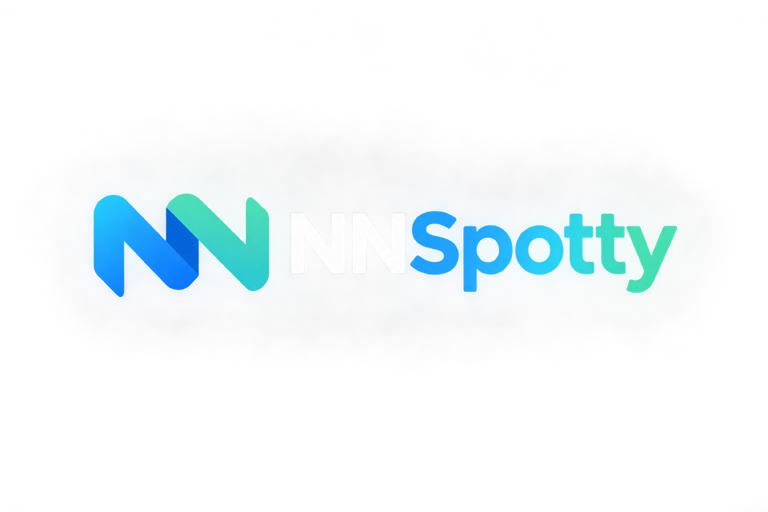

# NNSpotty

NNSpotty is een moderne Spotnet-webapplicatie voor het ophalen, browsen en downloaden van spots via Usenet.

## Functionaliteiten

- Spots en reacties ophalen via NNTP (php-nntp)
- Reacties schrijven en citeren in een ruime modal, direct vanuit de detailpagina
- Spot-overzicht met zoeken, filters, compacte hero-preview en uitgebreide detailpagina’s
- Newznab API ondersteuning met geindexeerde NZB-selectie en gedeelde titel-/metadatazoekindexen
- NZB downloaden en versturen naar SABnzbd of NZBGet: kies in Voorkeuren je standaard downloadclient, of eenmalig een andere via "Verzenden naar..."; wachtrij en snelheid in het Downloads-paneel
- Metadata-koppelingen (o.a. TMDB, TheTVDB, MusicBrainz, Fanart)
- Film-/seriedetails met regie, beschikbare TMDB-titelinformatie, doorzoekbare trefwoorden en suggesties onder "Meer zoals dit..."
- Metadata-cron met herbeoordeling, extra herkennings-/opschoonregels per type, bulkruns en live runstatus in admin
- Poster- en fanartgalerijen bij films/series: klik de cover voor overige posters, of het media-icoon naast de trailer voor fanart. Bladeren met knoppen, pijltjestoetsen of swipen; afbeeldingen laden pas bij bekijken.
- Admin beheerpanel voor systeeminstellingen
- Release-updater via CLI en webinterface, met releasemelding in de sidebar en afzonderlijk groepsrecht
- Gebruikers, rollen, rechten en persoonlijke preferences
- Persoonlijke historie met tabs Bekeken/Gedownload (SABnzbd, NZBGet, Newznab API en NZB-bestanden); geaggregeerde statistieken met grafieken achter het groepsrecht `statistics.view`
- Spotter moderatie (whitelist / blacklist)
- Gecontroleerde Spotnet-ID’s naast spotter- en reactienamen; reacties publiceren met een persoonlijke accountsleutel en Spotweb-compatibele message-ID-handtekening
- Light en dark thema (Plex-geïnspireerde UX)

## Screenshots

Klik op een preview voor de originele screenshot op volledige grootte.

| Donker thema | Licht thema | Spotdetails |
| --- | --- | --- |
| [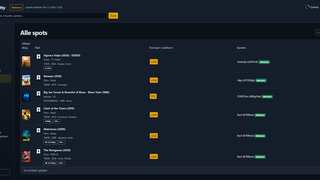](docs/screenshots/overview-dark.png) | [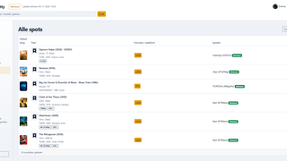](docs/screenshots/overview-light.png) | [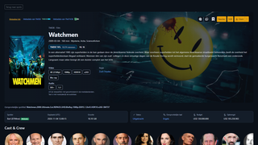](docs/screenshots/detail.png) |

| Postergalerij | Fanartgalerij | Trailer |
| --- | --- | --- |
| [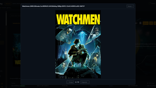](docs/screenshots/poster-gallery.png) | [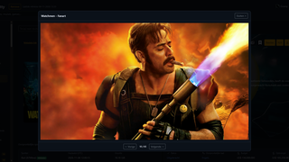](docs/screenshots/fanart-gallery.png) | [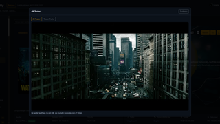](docs/screenshots/trailer.png) |

| Downloads | Voorkeuren | Statistieken |
| --- | --- | --- |
| [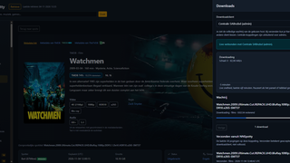](docs/screenshots/SABNZBD-NZBGET.png) | [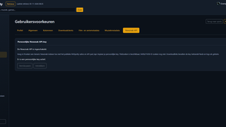](docs/screenshots/preferences.png) | [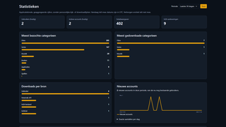](docs/screenshots/statistics.png) |

| Admin: Usenet | Admin: inhoud | Admin: downloadclients |
| --- | --- | --- |
| [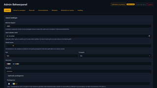](docs/screenshots/admin-usenet.png) | [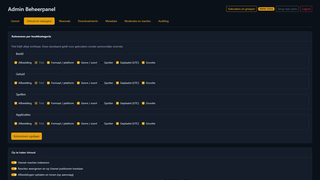](docs/screenshots/admin-inhoud.png) | [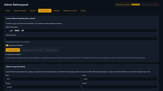](docs/screenshots/admin-client.png) |

| Admin: metadata |
| --- |
| [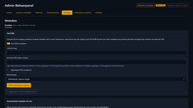](docs/screenshots/admin-metadata.png) |

## Vereisten

- PHP 8.2+
- MySQL 8.0+ of MariaDB 10.6+
- Composer
- PHP extensies: curl, dom, iconv, mbstring, openssl, pdo_mysql, simplexml, zlib

## Installatie (simpel)

1. Clone het project en ga naar de map.
2. Installeer dependencies met Composer.
3. Kopieer `.env.example` naar `.env` en vul je database + app settings in.
4. Draai de migraties.
5. Open de webapp.

Zie [docs/installation.md](./docs/installation.md) voor uitgebreide installatiehulp.

## CLI commando’s

Alle consolecommando’s staan in [docs/cli-commands.md](./docs/cli-commands.md).

## Metadata provider limits

Verifieerbare request-limieten en provider-notes staan in [docs/metadata-provider-limits.md](./docs/metadata-provider-limits.md).

## Externe resources

- [rvdv/nntp](https://packagist.org/packages/rvdv/nntp) (Usenet/NNTP)
- [Bootstrap](https://getbootstrap.com/) (UI)
- [TMDB](https://www.themoviedb.org/), [TheTVDB](https://thetvdb.com/), [MusicBrainz](https://musicbrainz.org/), [Fanart.tv](https://fanart.tv/) (metadata)
- [SABnzbd API](https://sabnzbd.org/wiki/advanced/api) (NZB forwarding)
- [NZBGet JSON-RPC API](https://nzbget.com/documentation/api/) (NZB forwarding)
